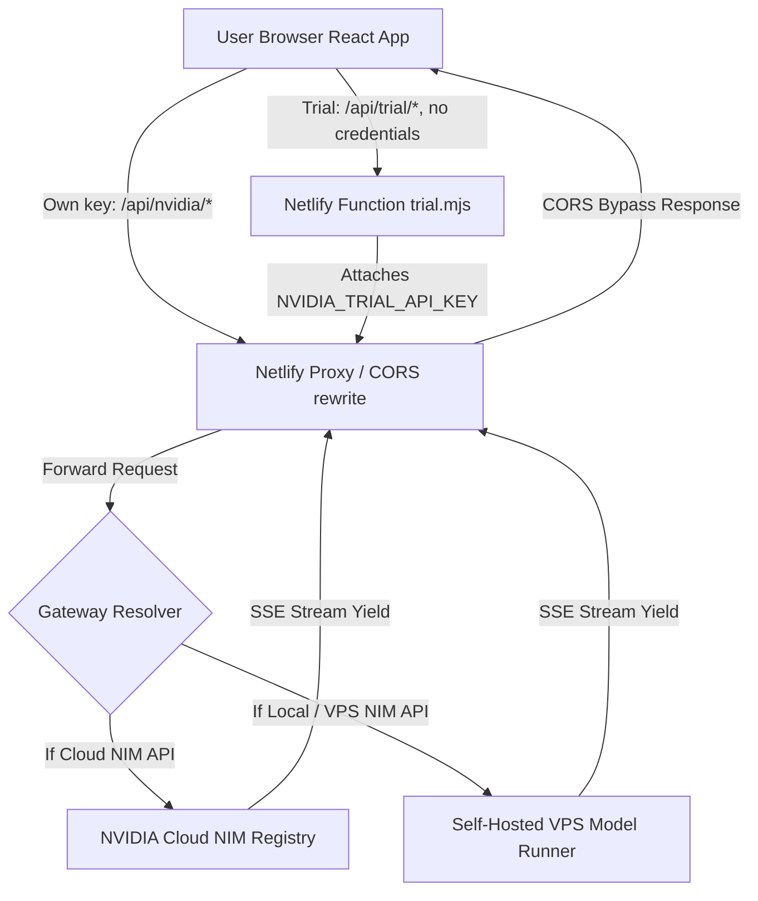
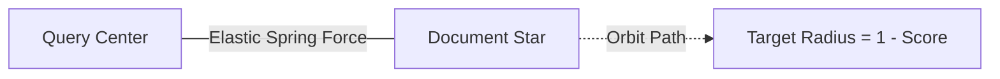

# milkyway.ai // Developer & Architecture Documentation

Welcome to the **milkyway.ai** comprehensive developer documentation. This guide is written in clear, plain English, aiming to provide future engineers with a smooth hand-off, covering all system architecture flows, API integrations, physics simulations, rendering mathematics, and stylesheet systems.

---

## Table of Contents
1. [Executive Summary](#1-executive-summary)
2. [System Architecture & Lifecycle](#2-system-architecture--lifecycle)
3. [API Integrations & Streaming Protocols](#3-api-integrations--streaming-protocols)
4. [Component Systems & Mechanical Mathematics](#4-component-systems--mechanical-mathematics)
    - [Constellation Visualizer](#constellation-visualizer)
    - [Text Embeddings & Physics Mapping](#text-embeddings--physics-mapping)
    - [Reasoning Waveform Engine](#reasoning-waveform-engine)
    - [CodeLab Compiler View](#codelab-compiler-view)
    - [Vision Lab Scanner](#vision-lab-scanner)
5. [State Management & Global Hooks](#5-state-management--global-hooks)
6. [Mobile Design System & CSS Variables](#6-mobile-design-system--css-variables)
7. [Local Setup & Deployment Instructions](#7-local-setup--deployment-instructions)
8. [Model Availability & Health](#8-model-availability--health)

---

## 1. Executive Summary

**milkyway.ai** is a deep-space developer dashboard designed to interactively showcase, benchmark, and prototype application models packaged as NVIDIA Inference Microservices (NIMs). The workspace is designed around an astronomical theme where models are represented as stars in a unified galaxy.

The application contains six workspaces:
1. **Constellation**: An interactive 2D star map of the model catalog.
2. **Chat Arena**: A prompt laboratory with custom system prompts and parameter controls.
3. **CodeLab**: A programming workspace that lifts code blocks out of replies.
4. **Reasoning Engine**: Shows a model's chain of thought beside its conclusion.
5. **Embedding Search**: Maps document similarity in 2D using cosine distance.
6. **Vision Lab**: Image question answering, plus a canvas-based region probe.

### Module map

```
netlify/functions/
└── trial.mjs              Shared-key gateway: attaches the trial key server-side

src/
├── api/nvidia.js          Gateway client: SSE parsing, streaming, cancellation
├── theme.js               Palette for canvas code (CSS vars do not work there)
├── hooks/                 useApiKey, useModels, useStream, useModelPicker,
│                          useStreamTelemetry, useMediaQuery
├── lib/                   gateway (key → route), providers (model → publisher),
│                          errors (message → guidance), clipboard
├── components/
│   ├── shared/            ModelSelect, MarkdownMessage, StreamTelemetry
│   └── <workspace>/       One directory per workspace
└── index.css              Design tokens and every shared class
```

---

## 2. System Architecture & Lifecycle

The application operates as a Serverless Single Page Application (SPA). Because directly querying external APIs like NVIDIA's API gateway (`integrate.api.nvidia.com`) from a client browser throws CORS (Cross-Origin Resource Sharing) blockages, all requests are proxied.

### Request Lifecycle Flow


### Serverless Rewrite Definition
In [netlify.toml](netlify.toml), a rewrite route transparently maps all `/api/nvidia/*` path requests directly to the NVIDIA API gateway, automatically appending splat coordinates:

```toml
[[redirects]]
  from = "/api/nvidia/*"
  to = "https://integrate.api.nvidia.com/v1/:splat"
  status = 200
  force = true
```

During local development, the Vite server uses built-in proxy overrides matching the same routing schema to prevent CORS blockages.

### The trial gateway

A second route, `/api/trial/*`, exists so a visitor with no NVIDIA account can still use the app. It is rewritten to [trial.mjs](netlify/functions/trial.mjs) rather than to NVIDIA, because the credential must not travel through the browser:

```toml
[[redirects]]
  from = "/api/trial/*"
  to = "/.netlify/functions/trial/:splat"
  status = 200
  force = true
```

The function reads `NVIDIA_TRIAL_API_KEY` from the server environment — deliberately *without* a `VITE_` prefix, so Vite cannot inline it into the bundle — builds a fresh header set (nothing the client sent is forwarded, least of all an `Authorization` header it may have supplied), and streams the upstream response body straight back so SSE still arrives token by token.

Because the endpoint takes no credentials, it is open to whoever finds it. The function bounds the damage rather than pretending otherwise: a three-route allowlist, a 512-token ceiling on generation, a 4 MB body limit, and a per-IP rate limit of 150/minute and 700/hour held in instance memory. The per-minute figure is set above the startup health sweep's burst (~100 probes, five at a time) so the sweep does not throttle itself into false verdicts. Netlify may keep several instances warm, so the counters are a brake, not a guarantee — the dependable ceiling is the quota on the key itself.

Which route a request takes is decided in [gateway.js](src/lib/gateway.js) from the active key: a real `nvapi-…` key resolves to `/api/nvidia` with an `Authorization` header, and the trial sentinel resolves to `/api/trial` with none. Both [nvidia.js](src/api/nvidia.js) and the health [probe.js](src/lib/health/probe.js) build their requests through it, which is why nothing else in the app has a branch for trial mode.

`npm run dev` approximates the function with a Vite proxy that attaches the same key; `npx netlify dev` runs the real one, caps and all.

---

## 3. API Integrations & Streaming Protocols

All communication with the underlying model endpoints is declared in [nvidia.js](src/api/nvidia.js). The module uses **Server-Sent Events (SSE)** and JavaScript Generator functions (`async function*`) to stream tokens in real time.

### Streaming Mechanics
Each response from the API is read chunk by chunk using a `ReadableStreamDefaultReader` and translated back to plain text via a standard `TextDecoder`. Because network packets can slice JSON chunks mid-character, the parser maintains an internal buffer to sew lines together:

```javascript
buffer += decoder.decode(value, { stream: true })
const lines = buffer.split('\n')
buffer = lines.pop() // Hold the incomplete trailing line in buffer
```

All four streaming helpers share one parser, `streamSSE`. Buffering, `[DONE]`
handling, malformed-frame recovery, and reader cleanup live there rather than
being repeated per endpoint.

### Reasoning Stream Extraction

Reasoning models publish their chain of thought in one of two ways, and
`streamReasoning` handles both.

**A separate delta field.** Current NIM reasoning models — the Nemotron family,
DeepSeek-R1 and similar — return their working in `reasoning_content` (some
spell it `reasoning`), alongside the answer in `content`:

```javascript
const reasoningDelta = (chunk) => {
  const delta = chunk.choices?.[0]?.delta
  return delta?.reasoning_content || delta?.reasoning || ''
}
```

**Inline tags.** Older models wrap their working in `<think>…</think>` inside
`content`. A single delta can straddle the closing tag, so it is split and each
half routed to its own channel:

```javascript
if (text.includes('</think>')) {
  inThinkTag = false
  const [thought, answer] = text.split('</think>')
  if (thought) yield { type: 'thinking', content: thought }
  if (answer) yield { type: 'answer', content: answer }
}
```

Either path produces the same typed stream — `{ type: 'thinking' | 'answer' }` —
which `useStream` routes into separate fields on the message, so the workspace
can show working and conclusion side by side.

### Cancellation

Every request accepts an `AbortSignal`. `useStream` exposes `stop()`, which
aborts the in-flight request, keeps whatever streamed in, and does not surface
an error — `isAbortError()` distinguishes a deliberate stop from a failure.
Workspaces abort on unmount, so navigating away stops paying for tokens.

---

## 4. Component Systems & Mechanical Mathematics

This section explains the visual features and underlying mathematical models utilized in the visual layers of the dashboard.

### Constellation Visualizer
Located in [Constellation.jsx](src/components/constellation/Constellation.jsx), this dashboard renders a dynamic, interactive celestial map of available models on an HTML5 `<canvas>` using a custom physical camera system.

#### 1. Coordinate Transforms
To support panning and zooming, the visualizer maps screen mouse positions to the virtual "world" coordinate space and back. 

- **World Coordinates to Screen Coordinates**:
  Given a node at world coordinates \((X_w, Y_w)\), a camera center \((Cam_x, Cam_y)\), screen dimensions \((W, H)\), and a zoom level \(Z\):
  \[X_s = (X_w - Cam_x) \cdot Z + \frac{W}{2}\]
  \[Y_s = (Y_w - Cam_y) \cdot Z + \frac{H}{2}\]

- **Screen Coordinates to World Coordinates (Mouse Unprojection)**:
  To find which star the cursor \((M_x, M_y)\) is hovering over in the virtual sky:
  \[X_w = \frac{M_x - W/2}{Z} + Cam_x\]
  \[Y_w = \frac{M_y - H/2}{Z} + Cam_y\]

#### 2. Damped Camera Physics
Camera movements use linear interpolation (LERP) to produce smooth transition animations when clicking categories or models:
\[Cam_{\text{actual}} = Cam_{\text{actual}} + (Cam_{\text{target}} - Cam_{\text{actual}}) \cdot K\]
Where the dampening factor \(K \approx 0.08\) per frame.

---

### Text Embeddings & Physics Mapping
Located in [EmbeddingSearch.jsx](src/components/embeddings/EmbeddingSearch.jsx), this playground maps text nodes in a 2D vector space.

#### 1. Cosine Similarity Mathematics
Embeddings translate sentences into high-dimensional coordinate arrays. When a user runs a similarity search, the application calculates the cosine similarity between the query vector \(\mathbf{Q}\) and each document vector \(\mathbf{D}\):

\[\text{Cosine Similarity}(\mathbf{Q}, \mathbf{D}) = \frac{\mathbf{Q} \cdot \mathbf{D}}{\|\mathbf{Q}\| \|\mathbf{D}\|} = \frac{\sum_{i=1}^{N} Q_i D_i}{\sqrt{\sum_{i=1}^{N} Q_i^2} \sqrt{\sum_{i=1}^{N} B_i^2}}\]

The output is a scalar match percentage between \(-1\) and \(1\) (typically normalized between \(0\) and \(1\) for text matches).

#### 2. Vector Space Attraction Physics
To visualize these similarities, the canvas acts as a physics simulator where nodes are placed in orbit. When a query is searched:
1. The query vector acts as a central gravitational pull at the center of the canvas \((C_x, C_y)\).
2. The **target distance** \(D_{\text{target}}\) from the center for each document node is proportional to its similarity score:
   \[D_{\text{target}} = (1 - \text{score}) \cdot R_{\text{max}}\]
   Where \(R_{\text{max}} = 240\) pixels. If a document has a \(100\%\) match (score = 1.0), its target distance is 0 (directly in the center).
3. **Elastic Physics Force**: Every frame, nodes accelerate towards their target distance:
   \[F_x = \frac{dx}{D_{\text{current}}} \cdot (D_{\text{target}} - D_{\text{current}}) \cdot K_{\text{elastic}}\]
   \[F_y = \frac{dy}{D_{\text{current}}} \cdot (D_{\text{target}} - D_{\text{current}}) \cdot K_{\text{elastic}}\]
   Where \(K_{\text{elastic}} = 0.08\), and a friction factor of \(0.88\) is applied to velocities to prevent perpetual oscillation.



---

### Reasoning Waveform Engine
In [ReasoningEngine.jsx](src/components/reasoning/ReasoningEngine.jsx), a synthetic brainwave waveform is drawn in real time during model inference.

#### Waveform Synthesis Equation
The canvas renders multiple overlapping sine waves. The vertical coordinate \(y\) of each line at horizontal coordinate \(x\) is calculated using a dynamic amplitude, frequency, and phase offset:

\[y(x) = y_{\text{center}} + A \cdot \sin(x \cdot f + \phi + \phi_{\text{offset}}) \cdot \text{Damp}(x)\]

Where:
- \(A\) (amplitude) expands from \(2\) to \(12\) pixels when the model is thinking.
- \(f\) (frequency) fluctuates between \(0.012\) (resting) and \(0.035\) (active).
- \(\phi\) (phase offset) increments every frame to animate the wave leftward.
- \(\text{Damp}(x)\) is a bell curve dampening function keeping wave edges bound to the boundaries of the canvas:
  \[\text{Damp}(x) = \sin\left(\frac{x}{W} \cdot \pi\right)\]
  This dampens the waves to \(0\) at the left (\(x=0\)) and right (\(x=W\)) borders, keeping the visual centered.

---

### CodeLab Compiler View
In [CodeLab.jsx](src/components/code/CodeLab.jsx), a developer interface splits space between code instruction logs and the preview terminal.
- **Markdown Renderer**: Processes standard codeblocks, applying syntax styling using Prism style tokens.
- **Toggle Parameter Deck**: Responsive states automatically collapse parameter columns (`showParams`) on mobile viewports:
  ```javascript
  const [showParams, setShowParams] = useState(() => window.innerWidth >= 768)
  ```

---

### Vision Lab Scanner
In [VisionLab.jsx](src/components/vision/VisionLab.jsx), a canvas overlay mimics a scanner frame. It allows developers to feed an image base64 coordinate array to a vision model (such as NVIDIA's Nemotron Vision NIM) and stream back descriptions or text extraction:
- **Base64 Packaging**: Encapsulates selected images inside standard data URI messages:
  ```javascript
  { type: 'image_url', image_url: { url: `data:${mimeType};base64,${imageBase64}` } }
  ```

---

## 5. State Management & Global Hooks

State lives in custom hooks rather than a store — the app has no cross-workspace
state beyond the API key and the model catalog.

| Hook | Responsibility |
| --- | --- |
| [useApiKey.js](src/hooks/useApiKey.js) | Resolves the key from `import.meta.env` or `localStorage`, synchronously on first render so the key modal never flashes for someone who already has one. Stores the trial sentinel the same way, so choosing the trial survives a reload. |
| [useModels.js](src/hooks/useModels.js) | Fetches the catalog, decorates each entry with category and context window, and caches it per key. |
| [useStream.js](src/hooks/useStream.js) | Owns the transcript: sends a turn, appends tokens, exposes `stop()`. |
| [useModelPicker.js](src/hooks/useModelPicker.js) | Resolves which model a workspace is using. |
| [useStreamTelemetry.js](src/hooks/useStreamTelemetry.js) | Measures time-to-first-token and throughput. |
| [useMediaQuery.js](src/hooks/useMediaQuery.js) | Breakpoint and `prefers-reduced-motion` state. |

### Deriving, not syncing

Two patterns recur, both chosen to avoid an effect that writes state:

**Model selection** is derived, never stored. Three inputs compete — a choice
made in this workspace, a model carried in from the map, and a default — and
`useModelPicker` resolves the winner on every render. Syncing that into state
from an effect would render one frame with the wrong model selected.

**Embedding index validity** is derived from the model id. Each document records
which model produced its vector; a document counts as indexed only when that
matches the current selection. Switching models therefore invalidates the index
by derivation, with no reset to run — and it *must* invalidate, because a vector
from one model scored against a query vector from another produces noise, not
similarity.

---

## 6. Mobile Design System & CSS Variables

The user interface uses a custom glassmorphism design system declared in [index.css](src/index.css).

### Colour Tokens

The accent is a violet nebula ramp. Each colour is declared twice — once as a
hex value, once as bare `r, g, b` channels — so translucent washes can be
written against the token instead of hard-coding the triple:

```css
:root {
  --bg-void:     #030309;   --bg-void-rgb:     3, 3, 9;
  --bg-panel:    #07071a;   --bg-panel-rgb:    7, 7, 26;
  --bg-elevated: #0c0c22;   --bg-elevated-rgb: 12, 12, 34;

  --nebula-deep: #5b21b6;   --nebula-deep-rgb:  91, 33, 182;
  --nebula-core: #7c3aed;   --nebula-core-rgb: 124, 58, 237;
  --nebula-glow: #a78bfa;   --nebula-glow-rgb: 167, 139, 250;
  --nebula-pale: #ddd6fe;   --nebula-pale-rgb: 221, 214, 254;
}

/* Usage */
border: 1px solid rgba(var(--nebula-core-rgb), 0.15);
```

Accents each carry one meaning and appear nowhere else: `--accent-blue` for the
person speaking, `--accent-violet` for generated code, `--accent-mint` for
success and strong matches, `--accent-pending` for work in progress, and
`--accent-coral` for errors and destructive actions.

### Canvas colours are not CSS variables

A canvas 2D context cannot resolve `var(--x)`. Assigning
`ctx.fillStyle = 'var(--nebula-glow)'` is silently ignored and the *previous*
fill colour stays in effect — a bug that produces plausible-looking output, so
it survives review easily.

Anything drawn to a canvas therefore reads its colours from
[src/theme.js](src/theme.js), which mirrors the `:root` block. **Change both
together.** `theme.js` also owns `CATEGORY_COLORS` (six distinguishable hues for
the model clusters) and `SIMILARITY_SCALE` (the match-strength ramp), so the
constellation map and the embedding map stay in step with the CSS.

### Motion

Ambient motion is atmosphere, not information. `prefers-reduced-motion` is
honoured in CSS for transitions and animations, and separately in JS by the
canvas render loops, which fall back to a single static frame or to direct
placement without physics.

### Mobile Layout Media Overrides (`(max-width: 767px)`)
- **Split Stack**: Flexible panes (`.arena-split`, `.codelab-split`, `.embeddings-split`, `.reasoning-split`) override to `flex-direction: column !important` on mobile.
- **Scroll Constraints**: Wide SVG diagrams inside the "Our Story" page wrap inside a `100%` width parent with `overflow-x: auto`, keeping standard card envelopes clean on narrow screens.
- **Add-Doc Toggle**: Embedding custom document inserts collapse into a simple toggle button, saving screen height.
- **Select Inputs**: Model selectors scale dynamically (`.model-select-dropdown`) instead of retaining wide fixed desktop dimensions.

---

## 7. Setup & Run Instructions

To run the codebase locally:

### 1. Installation
Install project dependencies:
```bash
npm install
```

### 2. Development Execution
Launch the local development server:
```bash
npm run dev
```
The server will boot, by default routing local proxy redirects to:
👉 `http://localhost:5173/`

### 3. Trial Key (optional)
To switch on the "try it now" button, set the server-side key. On the deployment:
```bash
npx netlify env:set NVIDIA_TRIAL_API_KEY "nvapi-…"
```
Locally, add `NVIDIA_TRIAL_API_KEY=nvapi-…` to `.env`. With it unset the button
reports that the trial is switched off and the own-key path is unaffected.

### 4. Production Build
Compile the minified assets bundle:
```bash
npm run build
```
This produces optimized production assets inside the `/dist` directory. Netlify picks up this folder automatically on deploy.

---

## 8. Model Availability & Health

### The problem

`GET /v1/models` returns the catalog NVIDIA publishes to everyone. Each entry
carries `id`, `object`, `created` and `owned_by` — nothing about whether *your*
key may call it. On the account this was built against, **54 of 102 listed
models answer a real request with `404 Not found for account`**. Rendering that
list straight into a dropdown is why choosing a model used to feel like a
gamble.

### The zero-token availability probe

The gateway resolves the model *before* it validates the request body. That
ordering is the whole trick: send a body that is guaranteed to fail validation,
and the status code tells you which stage rejected it.

```js
POST /v1/chat/completions  { model, messages: [], max_tokens: 1 }

400  "The 'messages' field cannot be empty"   -> the model resolved; you have it
404  "Function '…': Not found for account"    -> you never had it
```

No inference runs, so **no tokens are spent**, and the whole catalog sweeps in
about 20 seconds at a concurrency of five. Three other invalid-body variants
were tried and rejected as unreliable: `max_tokens: 0` made one model run
inference anyway, and both a bad `temperature` and a missing `messages` key
produced false `404`s on a model that was actually entitled.

### Why availability alone is not enough

Measured against real inference calls:

| Verdict | Accuracy | Conclusion |
| --- | --- | --- |
| `404` → blocked | 6/6 correct | Reliable. Nothing entitled is ever hidden. |
| `400` → available | 10/14 worked | Entitled is not the same as serving. |
| timeout | 2/6 later worked | **A timeout is a cold start, not a failure.** |

That last row matters most. The app's own default chat model timed out on the
probe and then answered fine in 11 seconds. Anything that treats a timeout as
"down" hides working models — so timeouts are recorded as `cold` and retried
with a longer budget, never written off.

### Three signals, in increasing order of authority

1. **Entitlement sweep** — free, whole-catalog, on load. Cached for 24 hours,
   because entitlement is a property of the account rather than the moment.
2. **Liveness probe** — a real one-token call, run when a picker opens or a
   model is chosen. Costs a few tokens; cached for minutes, not hours.
3. **Real traffic** — every message the user sends reports back. Free,
   authoritative, and continuous. This is what makes the system self-correcting:
   a model that starts failing is marked within one request, and one that
   recovers is cleared the instant it answers.

Repeated failures back off exponentially (30s, doubling, capped at 15 minutes)
so a broken model is not polled forever, and any success resets the counter.

### Self-healing in practice

The workspaces feed only *usable* models into `useModelPicker`. Because that
list is derived from live health rather than stored, a model that starts failing
drops out of it and the selection moves to the next healthy one with no reset
logic anywhere. Verified by planting a false healthy verdict on a model known to
return `404`: it was offered, corrected on selection by the liveness probe,
removed from the list, and the selection moved on — before any message could be
sent.

### Specialist models

Safety classifiers, reward models, document parsers and translators are
chat-shaped without being chat: they pass every availability check and then
return a verdict or a score instead of a reply. They are categorised as
`specialist` so they never appear in the chat picker.
